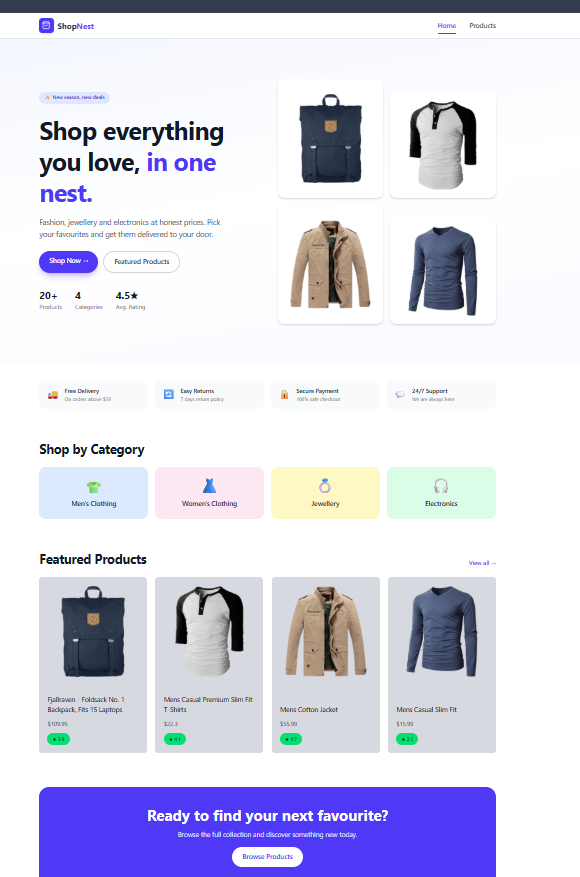

ShopNest 🛍️

ShopNest is a small e-commerce frontend that I built while learning React. It shows products from a public API, lets you open a single product page, and works as a Single Page Application (SPA).

Note: I am a beginner. Please read the "Honest note" section below to see how this project was made.

Features
Home page with a hero section, features strip, categories, featured products and a call-to-action banner
Products page that lists all products in a responsive grid, with a loader while data is loading
Single product page that opens when you click a product card and shows the image, title, category, price, rating and description
Navbar with active link styling (using NavLink)
Footer with quick links and contact info
Fully responsive layout for mobile, tablet and desktop
Hover effects and smooth transitions on cards, buttons and links
Tech Stack
React
React Router (createBrowserRouter and RouterProvider)
Axios for API calls
Tailwind CSS for styling
Fake Store API for product data
Routing

The app is a SPA, so pages change without a full browser reload. Routing is set up with createBrowserRouter and RouterProvider.

Route	Page
/	Home
/product	All products
/product/:id	Single product (dynamic route)
Dynamic routing: the single product page reads the id from the URL with useParams and fetches that product from the API.
NavLink: used in the navbar to highlight the page you are currently on.
Honest note

I am a beginner, so I want to be clear about how this project was made:

I built it by following a tutorial, and then tried to understand each part instead of only copying it.
The UI of the Home page, the Footer and the Single Product page was made with AI.
I tried to use component-based functions as much as possible, for example separate Product, Menu and Loader components.
I understand some parts well, and some parts only a little. I am still learning, especially useState, useEffect and passing data between components.
Run Locally
bash

## AND ITS A FULLY MOBILE RESPONCIVE WEBAPP ##

Live at  https://e-commerce-webapp-using-react-wav5.vercel.app